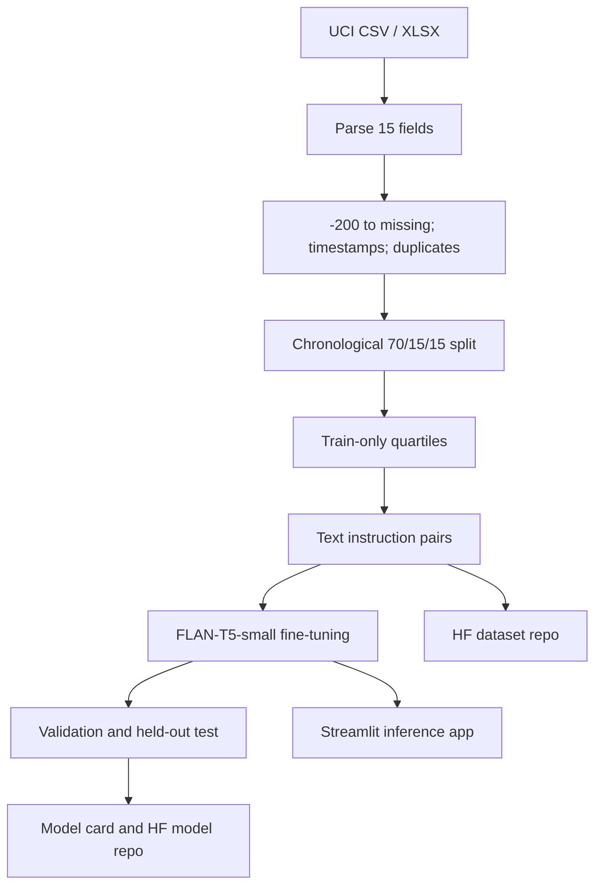

# AirQuality-SLM

### Design Thinking for Explainable Historical Air-Quality Interpretation

[](https://www.python.org/)
[](https://huggingface.co/google/flan-t5-small)
[](https://archive.ics.uci.edu/dataset/360/air+quality)
[](https://huggingface.co/datasets/prajwal90/AirQuality-SLM-Processed)

> A reproducible research project that transforms the UCI Air Quality time series into leakage-safe, language-based supervision for fine-tuning a compact encoder-decoder language model.

## Evidence dashboard

This table is the authoritative boundary between **measured work** and **planned model work** as of **12 November 2026**. The repository never substitutes expected values for experimental results.

| Deliverable | Verifiable evidence | Status |
|---|---|:---:|
| Source-data audit and preprocessing | `src/preprocess.py`, raw-data SHA-256, preprocessing log | ✅ Completed |
| Chronological train/validation/test split | 13,098 / 2,808 / 2,808 instruction pairs; disjoint record IDs | ✅ Completed |
| Automated data-invariant checks | `tests/` and documented split boundaries | ✅ Passed |
| Hugging Face dataset publication | Public dataset with three split files and metadata | ✅ Published |
| FLAN-T5-small training implementation | `src/train.py` and fixed configuration | ✅ Implemented |
| Fine-tuned model checkpoint | Requires missing dependencies and base-model download | ⛔ Not Run |
| Held-out model metrics and six prompt outputs | Requires a trained checkpoint | ⛔ Not Run |
| Streamlit model inference | UI implemented; launch requires model dependencies/checkpoint | ⚠️ Not Verified |

**Current conclusion:** the dataset engineering and supervision pipeline are complete and auditable. FLAN-T5-small fine-tuning and model-dependent evaluation are not claimed as completed. See [Training methodology](#training-methodology) for the recorded blocker.

## Table of contents

1. [Project overview](#project-overview)
2. [Design thinking methodology](#design-thinking-methodology)
3. [Dataset documentation](#dataset-documentation)
4. [Processing and splitting](#processing-and-splitting)
5. [SLM architecture](#slm-architecture)
6. [Training methodology](#training-methodology)
7. [Validation, testing, and results](#validation-testing-and-results)
8. [Prompt engineering](#prompt-engineering)
9. [System architecture](#system-architecture)
10. [Application](#application)
11. [Project structure](#project-structure)
12. [Installation and reproduction](#installation-and-reproduction)
13. [Hugging Face and GitHub](#hugging-face-and-github)
14. [Limitations and future work](#limitations-and-future-work)
15. [Requirement evidence matrix](#requirement-evidence-matrix)
16. [References](#references)
17. [Conclusion](#conclusion)

## Project overview

**Official title:** *Applying Design Thinking to Build a Small Language Model on the UCI Air Quality Dataset*.

**Abstract.** This project converts hourly numerical measurements from the UCI Air Quality dataset into instruction-response pairs for a compact text-to-text model. The proposed model, `google/flan-t5-small`, learns to classify CO, NO₂, and benzene readings relative to quartiles fitted only on the training period and to express the same result in a constrained factual sentence. The implemented pipeline preserves time order, converts the UCI `-200` missing marker to null, prevents source-hour overlap, and records hashes and split boundaries. Dataset preparation succeeded. Model fine-tuning and measured model evaluation have not yet run in this environment.

The problem is not ordinary numerical regression. A language model requires token sequences and target text. Therefore deterministic preprocessing converts selected measurements into natural-language instructions and supervised answers. This rule-based conversion creates the training signal; it is not itself an SLM and must not be presented as model inference.

**Objectives** are to build a reproducible data pipeline, create leakage-safe train/validation/test splits, fine-tune a genuine SLM, measure held-out performance, expose inference through Streamlit, and publish auditable dataset/model repositories when credentials and dependencies are available.

**Scope.** The system describes historical measurements relative to this dataset's training distribution. It does not calculate an official AQI, diagnose health risk, identify pollution sources, or provide real-time monitoring.

## Design thinking methodology

| Stage | Evidence and decision |
|---|---|
| Empathize | Personas: students who need understandable sensor readings, instructors who need reproducible evidence, and developers who need a small locally deployable model. Their pain points are opaque sensor columns, missing values, leakage, and unsupported claims. |
| Define | “How might we turn historical measurements into cautious natural-language interpretations while retaining provenance and preventing future data from influencing training?” |
| Ideate | Considered threshold-only UI, conventional classifier, regression, and text-to-text SLM. FLAN-T5-small was chosen because the assignment requires language output and the model is compact enough for an 8 GB consumer GPU. |
| Prototype | Implemented CSV parsing, chronological splits, train-only quartiles, two instruction types, FLAN-T5 training/evaluation scripts, and a Streamlit client. |
| Test | Data invariants passed. Model-dependent tests remain blocked until dependencies and the base checkpoint are available. See [DESIGN_THINKING.md](DESIGN_THINKING.md). |

## Dataset documentation

Source: [UCI Machine Learning Repository, Air Quality (ID 360)](https://archive.ics.uci.edu/dataset/360/air+quality), DOI `10.24432/C59K5F`. Measurements cover March 2004 to April 2005 in an Italian city. UCI metadata reports **9,358 instances**; the supplied CSV yields **9,357 valid timestamped measurement observations** after excluding the header and 114 completely blank trailing rows. Both figures are reported explicitly so the repository does not conceal the one-row discrepancy between repository metadata and the physical file.

| Variable | Meaning | Unit / encoding |
|---|---|---|
| Date | Measurement date | `DD/MM/YYYY` |
| Time | Measurement time | `HH.MM.SS` |
| CO(GT) | Reference carbon monoxide | mg/m³ |
| PT08.S1(CO) | Tin-oxide sensor nominally targeted to CO | sensor response (arbitrary units) |
| NMHC(GT) | Reference non-methane hydrocarbons | µg/m³ |
| C6H6(GT) | Reference benzene | µg/m³ |
| PT08.S2(NMHC) | Tin-oxide sensor nominally targeted to NMHC | sensor response (arbitrary units) |
| NOx(GT) | Reference nitrogen oxides | ppb |
| PT08.S3(NOx) | Tungsten-oxide sensor nominally targeted to NOx | sensor response (arbitrary units) |
| NO2(GT) | Reference nitrogen dioxide | µg/m³ |
| PT08.S4(NO2) | Tungsten-oxide sensor nominally targeted to NO₂ | sensor response (arbitrary units) |
| PT08.S5(O3) | Indium-oxide sensor nominally targeted to O₃ | sensor response (arbitrary units) |
| T | Temperature | °C |
| RH | Relative humidity | % |
| AH | Absolute humidity | g/m³ (as documented by UCI) |

After converting `-200` to missing, the largest gap is `NMHC(GT)` (8,443 of 9,357 observations). CO has 1,683 missing, NO₂ 1,642, NOx 1,639, and each sensor/meteorological series in the common outage group has 366. Full provenance and limitations are in [DATASET_CARD.md](DATASET_CARD.md) and machine-readable values are in [`data/processed/dataset_info.json`](data/processed/dataset_info.json).

## Processing and splitting

[`src/preprocess.py`](src/preprocess.py) performs the following:

1. Reads the semicolon-delimited CSV using UTF-8 BOM handling and preserves decimal commas.
2. Validates all 15 required columns.
3. Parses `Date + Time` into a sortable timestamp.
4. Converts blanks, non-finite values, and the UCI `-200` sentinel to `None`.
5. Deduplicates by timestamp, retaining the first observation. No duplicates were found.
6. Sorts chronologically and splits source hours **before** prompt generation.
7. Fits 25th/75th percentile thresholds only on non-missing training readings.
8. Generates one `classify` and one `explain` example per source hour.
9. Writes three CSVs, hashes, boundaries, missing counts, and validation evidence.

| Split | Ratio | Source hours | Instruction examples | Period |
|---|---:|---:|---:|---|
| Train | 70.0% | 6,549 | 13,098 | 2004-03-10 18:00 to 2004-12-08 14:00 |
| Validation | 15.0% | 1,404 | 2,808 | 2004-12-08 15:00 to 2005-02-05 02:00 |
| Test | 15.0% | 1,404 | 2,808 | 2005-02-05 03:00 to 2005-04-04 14:00 |

No random seed applies to splitting because it is deterministic and chronological. Chronological separation imitates deployment on later observations and prevents future-period distribution information from leaking backward. Random splitting would mix adjacent hours from the same sensor campaign and overstate generalization. Seed `42` is reserved for model training.

Train-only thresholds are CO `q25=1.1`, `q75=2.8` mg/m³; NO₂ `69`, `123` µg/m³; and benzene `5.1`, `14.6` µg/m³. These are descriptive dataset quartiles, not safety limits.

## SLM architecture

`google/flan-t5-small` is an instruction-tuned encoder-decoder Transformer with approximately **80 million parameters**. The encoder creates contextual representations of the input instruction; the autoregressive decoder generates the target answer token by token. T5 uses a SentencePiece tokenizer and a text-to-text interface.

It qualifies as a Small Language Model in this project because its parameter count is orders of magnitude below multi-billion-parameter LLMs and it can be fine-tuned/inferred on consumer hardware. It was preferred over a decoder-only LLM for lower compute cost, constrained short outputs, mature Hugging Face support, and alignment with conditional generation. Configured maximum lengths are 256 source tokens and 64 target tokens.

## Training methodology

The implemented configuration is FLAN-T5-small full fine-tuning with AdamW (the Trainer default), learning rate `5e-5`, batch size `8`, three epochs, seed `42`, FP16 when CUDA is available, validation and checkpointing each epoch, two-checkpoint retention, and best-model restoration. Hardware detected: NVIDIA GeForce RTX 4060 Laptop GPU (8 GB). Intended software is Python 3.12, PyTorch 2.x, Transformers 4.x, Datasets 3/4.x, Accelerate 1.x, and SentencePiece 0.2.x.

**Measured training status: Blocked / Not Run.** PyTorch 2.14.1+cu126 is installed and CUDA hardware is present, but `transformers`, `datasets`, `accelerate`, `sentencepiece`, and `streamlit` are absent. Dependency installation failed because DNS could not resolve `pypi.org`; the FLAN-T5-small checkpoint is not cached. Consequently there are no checkpoints or loss curves. See [TRAINING_REPORT.md](TRAINING_REPORT.md).

## Validation, testing, and results

### Completed data checks

- Parsed 9,357 dated observations from the supplied source.
- Verified zero invalid timestamps and zero duplicate timestamps.
- Verified strict train < validation < test temporal boundaries.
- Verified no `record_id` intersection among splits.
- Verified exactly two generated examples per source hour.
- Recorded SHA-256 for the source and every processed split.

### Planned model metrics

- Exact match: $EM = \frac{1}{N}\sum_{i=1}^{N}\mathbf{1}[\hat{y}_i=y_i]$ after lowercase/whitespace normalization.
- Token F1: harmonic mean $F_1=2PR/(P+R)$ computed from overlapping normalized tokens.
- Validation/test loss: teacher-forced cross-entropy reported by the Trainer.
- Optional ROUGE-L for explanatory text after the core evaluator runs.

The deterministic-label baseline can reproduce labels directly from quartiles, but it is **not a language model baseline**. Its expected exact match on generated targets is 1.0 by construction and must not be compared as learned generalization. FLAN-T5 base-model evaluation and fine-tuned-model evaluation have not run. Actual losses, test scores, predictions, and graphs are therefore unavailable. See [EVALUATION_REPORT.md](EVALUATION_REPORT.md).

## Prompt engineering

Three positive and three negative/adversarial tests are fully specified in [PROMPT_TEST_RESULTS.md](PROMPT_TEST_RESULTS.md). Actual SLM responses and pass/fail values are marked **Not Run** because there is no trained checkpoint. Positive tests cover complete readings, missing values, and constrained explanation. Negative tests probe prompt injection, unsupported health claims, and fabricated pollution reports.

## System architecture



Solid implementation currently reaches the instruction-pair stage. Downstream model-dependent stages are present as code but not experimentally completed.

## Application

[`app.py`](app.py) provides task selection, CO/NO₂/benzene inputs, model-path selection, generated output, and transparent failure messaging. It loads only an actual Transformers checkpoint; it does not silently replace a missing model with rules. Launch verification and screenshots are **Not Run** because Streamlit and Transformers are not installed.

## Project structure

```text
.
├── app.py                         # Streamlit model-inference UI
├── src/
│   ├── preprocess.py              # source validation, splitting, text supervision
│   ├── train.py                   # FLAN-T5-small fine-tuning
│   └── evaluate.py                # held-out generation, EM and token F1
├── data/
│   ├── raw/                       # supplied UCI CSV/XLSX
│   └── processed/                 # train/validation/test + dataset_info.json
├── artifacts/                     # runtime results; checkpoint weights ignored by Git
├── tests/                         # pipeline invariants
├── README.md                      # primary technical report
├── PROJECT_REPORT.md              # research-style narrative
├── TRAINING_REPORT.md             # training status/configuration
├── EVALUATION_REPORT.md           # model/data evaluation evidence
├── DATASET_CARD.md                # provenance, schema, biases
├── MODEL_CARD.md                  # intended model and status
├── DESIGN_THINKING.md             # five-stage process
├── PROMPT_TEST_RESULTS.md          # six controlled tests
├── REPRODUCIBILITY.md             # exact commands
└── SUBMISSION.md                  # verified/unverified publication links
```

## Installation and reproduction

```powershell
git clone https://github.com/DSGAMING98/AirQuality-SLM-DT.git
cd AirQuality-SLM-DT
py -3.12 -m venv .venv
.\.venv\Scripts\Activate.ps1
python -m pip install --upgrade pip
python -m pip install -r requirements.txt

python src\preprocess.py --csv data\raw\AirQualityUCI.csv --out data\processed
python -m unittest discover -s tests -v
python src\train.py --data-dir data\processed --output-dir artifacts\flan-t5-airquality
python src\evaluate.py --model artifacts\flan-t5-airquality\best_model
streamlit run app.py
```

For exact commands, expected files, checks, and Hugging Face loading instructions, read [REPRODUCIBILITY.md](REPRODUCIBILITY.md).

## Hugging Face and GitHub

The dataset layout follows the reference [Rotten Tomatoes dataset repository](https://huggingface.co/datasets/cornell-movie-review-data/rotten_tomatoes): YAML metadata, explicit split files, a dataset card, and load instructions. The public [Hugging Face dataset](https://huggingface.co/datasets/prajwal90/AirQuality-SLM-Processed) contains `train.csv`, `validation.csv`, `test.csv`, `dataset_info.json`, and its dataset card. The complete project is published in the public [GitHub repository](https://github.com/DSGAMING98/AirQuality-SLM-DT). Model publication remains **Not Published** because no trained checkpoint exists.

## Limitations and future work

- Measurements are historical (2004–2005), single-site, and not real time.
- Extensive missingness, especially NMHC, limits tasks and supervision.
- Generated labels encode dataset quartiles, not human judgment, legal limits, official AQI, or health risk.
- Geography, traffic, weather context, calibration drift, and causal source labels are unavailable.
- A seq2seq model may hallucinate units/categories or follow malicious instructions.
- No trained checkpoint or model metrics exist yet; application capability is not established.

Future work includes dependency-enabled fine-tuning, base-vs-fine-tuned comparison, repeated seeds, calibrated confidence, human review, newer multi-location datasets, live sensor integration, multilingual explanations, ONNX/8-bit quantization, edge deployment, and robustness/fairness/security testing.

## Requirement evidence matrix

| Assignment requirement | Evidence | Status |
|---|---|---|
| UCI data and 15 variables | README Dataset; `DATASET_CARD.md`; raw files | Completed |
| `-200`, timestamps, duplicates | `src/preprocess.py`; `dataset_info.json` | Completed |
| Train/validation/test | three CSVs + hashes/boundaries | Completed |
| Leakage prevention | chronological split + tests | Completed |
| FLAN-T5-small architecture | README; `MODEL_CARD.md`; `src/train.py` | Code complete; training blocked |
| Training/validation/test metrics | `TRAINING_REPORT.md`; `EVALUATION_REPORT.md` | Not Run |
| Six prompts | `PROMPT_TEST_RESULTS.md` | Defined; responses Not Run |
| Streamlit | `app.py` | Implemented; launch Not Run |
| HF dataset/model | `SUBMISSION.md` | Dataset published; model Not Run |
| Reproduction | `requirements.txt`; `REPRODUCIBILITY.md` | Completed for code/data stage |
| GitHub documentation | README and nine reports | Published |

## References

1. De Vito, S. et al. UCI Air Quality dataset. DOI: [10.24432/C59K5F](https://doi.org/10.24432/C59K5F).
2. De Vito, S. et al. (2008). *On field calibration of an electronic nose for benzene estimation in an urban pollution monitoring scenario*. Sensors and Actuators B, 129(2), 750–757.
3. Raffel, C. et al. (2020). [Exploring the Limits of Transfer Learning with a Unified Text-to-Text Transformer](https://jmlr.org/papers/v21/20-074.html).
4. Chung, H. W. et al. (2022). [Scaling Instruction-Finetuned Language Models](https://arxiv.org/abs/2210.11416).
5. Hugging Face. [FLAN-T5-small model card](https://huggingface.co/google/flan-t5-small).
6. Hugging Face. [Transformers seq2seq training documentation](https://huggingface.co/docs/transformers/tasks/summarization).
7. Hugging Face. [Datasets repository structure](https://huggingface.co/docs/datasets/repository_structure).
8. Streamlit. [Documentation](https://docs.streamlit.io/).

## Conclusion

The project has a verified, reproducible data foundation: exact source hashing, documented missingness, chronological leakage-safe splitting, train-only threshold estimation, and 18,714 generated instruction examples across three disjoint splits. The FLAN-T5-small training and model-dependent claims remain explicitly incomplete because required packages/checkpoint downloads were unavailable. The repository therefore demonstrates genuine completed engineering without pretending that a model was fine-tuned when it was not.
