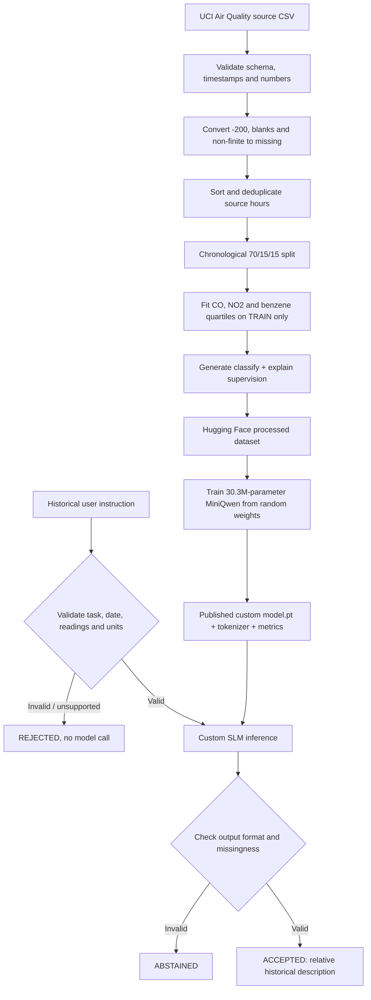
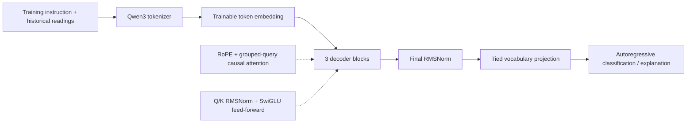

# AirQuality SLM
### Applying Design Thinking to Build a Small Language Model on the UCI Air Quality Dataset

**Project status (15 November 2026):** The dataset validation and preprocessing pipeline is complete. A custom **30,301,632-parameter, decoder-only, Qwen-inspired Small Language Model (SLM) has been trained from scratch** and published. Its standalone safe-inference layer passed six selected live-checkpoint tests in an independent Python process. The existing Streamlit app in this GitHub branch is **legacy FLAN-T5 code**, not yet the verified interface for this model.

This repository has **two distinct engineering phases**:

| Phase | Goal | Main deliverables | Status |
|---|---|---|---|
| **1. Data validation and preprocessing** | Turn historical sensor data into leakage-aware, auditable instruction/answer examples | `src/preprocess.py`, split CSVs, `dataset_info.json`, data tests, Hugging Face dataset | Complete |
| **2. From-scratch SLM and safe inference** | Train a real language model on those examples, evaluate it and guard against unsupported requests | `airquality_slm_model.py`, published `model.pt`, `metrics.json`, `safe_inference.py`, safety tests | Trained and independently tested |

> **Not an official AQI system.** Labels such as *low*, *typical* and *elevated* are **relative to training-set quartiles**. The system does not provide real-time readings, future forecasts, legal air-quality grades, source attribution or health-safety decisions.

## Repository and published artifacts

| Artifact | Location | What is verified |
|---|---|---|
| GitHub source and this documentation | [DSGAMING98/AirQuality-SLM-DT](https://github.com/DSGAMING98/AirQuality-SLM-DT) | Source, data pipeline, custom model class, CLI and tests |
| Processed dataset | [prajwal90/AirQuality-SLM-Processed](https://huggingface.co/datasets/prajwal90/AirQuality-SLM-Processed) | Published train/validation/test instructions |
| Trained SLM | [prajwal90/AirQuality-SLM-Scratch-Qwen](https://huggingface.co/prajwal90/AirQuality-SLM-Scratch-Qwen) | Published custom state dict, config, tokenizer, metrics and training plot |
| Standalone release | [safe_inference.py](safe_inference.py) and [RELEASE_NOTES_v1.1.md](RELEASE_NOTES_v1.1.md) | Selected live test: **6/6**; validator unit tests: **9/9** |
| Detailed dataset provenance | [DATASET_CARD.md](DATASET_CARD.md), [data/processed/dataset_info.json](data/processed/dataset_info.json) | Source audit, missingness, timestamps, split hashes |

## System overview



---

# Phase 1: Data Validation and Preprocessing

This phase is **deterministic data engineering**, not neural language-model inference. Its role is to convert an imperfect sensor record into a traceable training dataset while preventing obvious temporal leakage.

## 1.1 Source data and schema

Source: [UCI Machine Learning Repository, Air Quality, dataset 360](https://archive.ics.uci.edu/dataset/360/air+quality), DOI [10.24432/C59K5F](https://doi.org/10.24432/C59K5F). The historical collection spans **10 March 2004, 18:00** through **4 April 2005, 14:00**, from a single monitoring context in an Italian city.

The supplied file has **15 required fields**: two time fields and 13 measurement/sensor/environmental fields.

| Source column | Data description | Used for SLM labels? |
|---|---|---|
| `Date`, `Time` | Hourly timestamp; parsed from `DD/MM/YYYY` and `HH.MM.SS` | Time context and split order |
| `CO(GT)` | Reference carbon monoxide, mg/m³ | **Yes, CO** |
| `NO2(GT)` | Reference nitrogen dioxide, µg/m³ | **Yes, NO2** |
| `C6H6(GT)` | Reference benzene, µg/m³ | **Yes, benzene** |
| `NOx(GT)`, `NMHC(GT)` | Other reference pollutant measures | No |
| `PT08.S1(CO)` through `PT08.S5(O3)` | Five gas-sensor channels | No |
| `T`, `RH`, `AH` | Temperature, relative humidity, absolute humidity | No |

The additional fields are kept in the source audit but not included as targets in this three-pollutant instruction task.

## 1.2 Source-data validation

Implemented in [`src/preprocess.py`](src/preprocess.py). The parser:

1. Reads the semicolon-delimited file with UTF-8-BOM handling and decimal-comma normalization.
2. Verifies that all **15 required column names** are present.
3. Parses valid combined dates/times; skips empty tail rows and records invalid timestamps.
4. Converts `-200` (the UCI missing-data sentinel), blank values and non-finite/non-numeric measurements to missing values rather than treating them as zero.
5. Deduplicates by timestamp, retaining the first observation; sorts all valid observations chronologically.
6. Counts missing values and records SHA-256 hashes for reproducibility.

**Recorded source audit:**

| Check | Result |
|---|---:|
| Parsed, distinct timestamped measurements | **9,357** |
| File rows, including header and blank tail | **9,472** |
| Trailing blank CSV rows | **114** |
| Invalid timestamp rows | **0** |
| Duplicate timestamps removed | **0** |
| UCI metadata/listing context | **9,358** instances/rows reported; supplied CSV audit gives **9,357 observations** |

The 9,357 vs 9,358 distinction is retained rather than quietly changing the source record count. The source CSV SHA-256 recorded in `dataset_info.json` is:

```text
13277ae5d8581e80b7be09d47c7d3d06fe9b8e957078f2cf6e859f955e62f996
```

### Missing-value audit

| Source field | Missing after `-200` conversion | Interpretation |
|---|---:|---|
| `NMHC(GT)` | 8,443 | Extensive missingness |
| `CO(GT)` | 1,683 | Retained as unavailable when missing |
| `NO2(GT)` | 1,642 | Retained as unavailable when missing |
| `NOx(GT)` | 1,639 | Other reference gas |
| `C6H6(GT)` (benzene) | 366 | Retained as unavailable when missing |
| `PT08.S1`, `PT08.S2`, `PT08.S3`, `PT08.S4`, `PT08.S5`, `T`, `RH`, `AH` | 366 each | Sensor/environmental missingness |

**No fabricated imputation:** The chosen training targets use an explicit **unavailable** category when CO, NO2 or benzene is missing. This avoids presenting filled-in readings as direct observations.

## 1.3 Chronological train/validation/test split

The crucial rule is **split the unique source hours first, then create examples**. Each original hour produces two prompts; both prompts must belong to the same split.

| Split | Source hours | Instruction/answer examples | Historical period |
|---|---:|---:|---|
| Training | **6,549** | **13,098** | 2004-03-10 18:00 to 2004-12-08 14:00 |
| Validation | **1,404** | **2,808** | 2004-12-08 15:00 to 2005-02-05 02:00 |
| Held-out test | **1,404** | **2,808** | 2005-02-05 03:00 to 2005-04-04 14:00 |
| **Total** | **9,357** | **18,714** | Entire validated period |

This is an ordered approximately **70/15/15** split, not a random split. The timestamps in training end before validation begins, and validation ends before testing begins. `record_id` sets are disjoint across all three splits.

**What this does and does not prove:** it prevents *source-hour overlap* and *future-hour quartile fitting* across splits. It does not eliminate every possible form of temporal correlation, covariate shift, sensor calibration drift or generalization error.

## 1.4 Relative labels from training-only quartiles

For each pollutant, the pipeline calculates the **25th (Q1)** and **75th (Q3)** percentiles using **only non-missing training-period readings**, then freezes them for validation, testing and the generated instruction targets.

| Pollutant | Q1 (25th percentile) | Q3 (75th percentile) | Non-missing training readings |
|---|---:|---:|---:|
| CO | **1.1 mg/m³** | **2.8 mg/m³** | 5,066 |
| NO2 | **69 µg/m³** | **123 µg/m³** | 5,096 |
| Benzene | **5.1 µg/m³** | **14.6 µg/m³** | 6,401 |

Labeling logic used in `src/preprocess.py`:

- **unavailable:** missing sensor value;
- **low:** measured value strictly below Q1;
- **elevated:** measured value strictly above Q3;
- **typical:** value between Q1 and Q3, **including both boundaries**.

These categories describe this historical dataset, **not** a calibrated official AQI, air-quality standard or exposure-safety threshold.

## 1.5 Instruction dataset generation

For every validated hour, the pipeline produces **two supervised examples**:

**Classification instruction**

```text
Classify these historical air-quality measurements as low, typical, elevated or unavailable relative to training-distribution quartiles. Hour: 2005-03-08T08:00:00. CO: 3.40 mg/m3; NO2: 182.00 ug/m3; benzene: 18.30 ug/m3.
```

Target:

```text
CO: elevated; NO2: elevated; benzene: elevated.
```

**One-sentence explanation instruction**

```text
Explain these historical air-quality measurements in one factual sentence. Use relative historical quartiles only; do not infer official AQI, health safety or a pollution source. Hour: 2005-03-06T09:00:00. CO: 0.70 mg/m3; NO2: 79.00 ug/m3; benzene: 1.50 ug/m3.
```

Target:

```text
Relative to historical training data, CO is low, NO2 is typical, and benzene is low.
```

Each processed CSV stores: `text`, `label`, `task`, `record_id`, `timestamp`, `input_text` and `target_text`. The duplicated text/label columns make the data consumable by common text-to-text loading tools while retaining provenance.

**Important distinction:** quartile rules generate the *supervision labels*. They are not themselves the trained SLM, and a rule-based answer should not be misreported as a neural-model prediction.

## 1.6 Dataset integrity and reproducibility

Evidence is available in [`tests/test_pipeline.py`](tests/test_pipeline.py) and the [machine-readable metadata](data/processed/dataset_info.json).

Verified/recorded invariants cover:

- Exactly **6,549 / 1,404 / 1,404** source hours;
- Exactly **two examples per source hour**;
- No overlapping `record_id` values across splits;
- Strict historical train < validation < test boundaries;
- Source and generated-split SHA-256 values.

| Processed split | SHA-256 |
|---|---|
| `train.csv` | `d28759a9816ad2d50226fbd2df0eea69e2cbdf64ed04d7127f9e3d9316a587a4` |
| `validation.csv` | `d684890c81a02fd6f4aa31c2576ce804a34e74764fedc8325bfe06f50b2313d0` |
| `test.csv` | `470f28ced793f4504bfd3050a9873a5dc28875408de1d7a853f84336649617f9` |

To reproduce this **data-only phase** (assuming the official CSV is placed in `data/raw/`):

```powershell
python src/preprocess.py --csv data/raw/AirQualityUCI.csv --out data/processed
python -m unittest discover -s tests -p test_pipeline.py -v
```

See [DATASET_CARD.md](DATASET_CARD.md) for provenance and restrictions. The published data files are at [Hugging Face](https://huggingface.co/datasets/prajwal90/AirQuality-SLM-Processed).

---

# Phase 2: From-Scratch Small Language Model and Safe Inference

This phase is **learned text generation plus application-level verification**, building on Phase 1's supervised instruction/answer pairs.

## 2.1 Actual model, not a fine-tuned Qwen checkpoint

The completed experiment uses a **custom decoder-only MiniQwen-style Transformer**, coded in [`airquality_slm_model.py`](airquality_slm_model.py) and **trained from randomly initialized model weights**. Its layers borrow general Qwen-family architectural ideas, but **no pretrained Qwen weights were loaded**. The published **`Qwen/Qwen3-8B` tokenizer** supplies tokenization and a vocabulary, not pretrained neural reasoning or knowledge.

| Model property | Published configuration |
|---|---:|
| Trainable/unique model parameters | **30,301,632** |
| Vocabulary size | **151,669** |
| Transformer decoder layers | **3** |
| Hidden dimension (`d_model`) | **192** |
| Attention query heads | **6** |
| Attention key/value heads | **2** |
| Feed-forward dimension (`d_ff`) | **512** |
| Maximum context length (`max_seq_len`) | **160 tokens** |
| Architectural components | RoPE, grouped-query attention, Q/K RMSNorm, residual blocks, SwiGLU, causal attention |
| Output projection | Weight-tied to input-token embedding |
| Checkpoint | Custom PyTorch state dict `model.pt` |

The architecture is defined directly in PyTorch, not generated by calling an off-the-shelf `AutoModelForCausalLM.from_pretrained` model. The model generates output autoregressively with greedy next-token selection.

### Model structure



## 2.2 Training setup and checkpoints

| Experiment field | Recorded outcome |
|---|---|
| Training origin | From scratch, random weights |
| Optimizer updates | **4,000** |
| Loaded training examples | **13,098** |
| Loaded validation examples | **2,808** |
| Loaded held-out test examples | **2,808** |
| Per-step batch size | **2** |
| Gradient-accumulation steps | **2** |
| Maximum sequence length | **160** |
| Training machine | NVIDIA RTX 4060 Laptop GPU (8 GB VRAM), local Windows/Python environment |
| Checkpoint artifacts | `model.pt`, `model_config.json`, custom Python model implementation, tokenizer files |
| Publication | [AirQuality-SLM-Scratch-Qwen on Hugging Face](https://huggingface.co/prajwal90/AirQuality-SLM-Scratch-Qwen) |

The completed training run was performed in the project's notebook workflow. The repo's older `src/train.py` is a **separate, unexecuted FLAN-T5 experimental path** and **must not be used as proof or a reproduction script for this trained MiniQwen checkpoint**.

## 2.3 Evaluation results: measured vs interpreted

Values below come from [`metrics.json`](metrics.json), which mirrors the published checkpoint's metrics.

| Metric | Recorded value |
|---|---:|
| Best sampled validation loss | **0.002819679** |
| Full validation loss | **0.009190715** |
| Held-out test loss | **0.008156747** |
| Optimizer steps | **4,000** |
| Pretrained model weights used | **False** |

These are **cross-entropy losses**, **not** 99% accuracy, 99.9% precision, official AQI agreement or an externally validated pollution-classification score. The low losses should be understood in the context of highly templated, automatically generated supervision. Wider accuracy evaluation, calibration and out-of-distribution tests remain open.

Training graphs: [`training_curves.png` on Hugging Face](https://huggingface.co/prajwal90/AirQuality-SLM-Scratch-Qwen/blob/main/training_curves.png).

## 2.4 Independent checkpoint verification

The public checkpoint was independently downloaded, loaded on CPU through the repository's custom class, and checked with a strict PyTorch state-dictionary load (`weights_only=True`, `strict=True`). This verifies that the published weights and model code are structurally compatible. It does **not** prove the model is accurate on every possible input.

The portable CLI loads the checkpoint, configuration, tokenizer, and model source lazily through Hugging Face Hub. First use requires an internet connection or a previously downloaded local model folder. There is **no need to retrain**.

## 2.5 Robustness tests: raw model vs safe inference

Three positive and three negative/edge prompts were selected. In the **original model-only experiment**, valid prompts passed but two unsupported/malformed prompts failed. A separate deterministic validation wrapper was then applied **without changing any weights**.

| Case | Question tested | Original SLM alone | SLM with safe-inference layer |
|---|---|---|---|
| P1 | Complete high relative readings | PASS | **PASS** |
| P2 | A missing benzene reading | PASS | **PASS** |
| P3 | Constrained historical explanation | PASS | **PASS** |
| N1 | All three readings missing | PASS | **PASS** |
| N2 | Malformed numbers/units | FAIL: generated labels | **PASS: rejected before model call** |
| N3 | Future official AQI and exercise safety request | FAIL: repeated text | **PASS: rejected before model call** |
| **Selected-prompt total** | | **4/6** | **6/6** |

Additionally, the safe-inference Python module passed **9/9 offline validator unit tests**. On **15 November 2026**, the standalone CLI passed the six selected live-model checks **in a fresh Python process with exit code 0**.

**Do not interpret 6/6 as a population accuracy or safety benchmark.** It is evidence for these six chosen cases only. The two problematic prompts were safely rejected by application logic rather than magically corrected through neural retraining.

## 2.6 The input and output safety layer

Implemented in [`safe_inference.py`](safe_inference.py).

**Before calling the SLM:**

1. Accept only two supported templates: historical `Classify` and `Explain`.
2. Require an ISO timestamp within the dataset's historical range.
3. Require all three pollutant fields, expected units (CO: `mg/m3`; NO2/benzene: `ug/m3`), and finite nonnegative numeric readings.
4. Map `missing` and `-200` markers to **missing**, never to a real concentration.
5. **REJECT** malformed or out-of-scope requests before spending inference compute.

**After generation:**

1. Match the exact three-pollutant output structure or constrained one-sentence explanation.
2. Confirm that present readings are not labeled `unavailable` and missing readings are not assigned a numerical category.
3. Return **ACCEPTED** when the schema checks pass; **ABSTAINED** if model output is malformed/inconsistent; or **ERROR** if inference itself fails.

The validator checks syntax, task scope and missingness consistency. **It does not independently verify that every numeric category selected by the model is correct**, guarantee physical sensor plausibility or provide calibrated confidence.

### Run current verified CLI

Using a fresh Python environment and the published checkpoint:

```powershell
git clone https://github.com/DSGAMING98/AirQuality-SLM-DT.git
cd AirQuality-SLM-DT
python -m pip install torch "transformers>=4.51,<5" "huggingface_hub>=0.30"
python safe_inference.py --self-test --device cpu
python -m unittest discover -s tests -p test_safe_inference.py -v
```

One supported example:

```powershell
python safe_inference.py --device cpu --prompt "Classify these historical air-quality measurements as low, typical, elevated or unavailable relative to training-distribution quartiles. Hour: 2005-03-08T08:00:00. CO: 3.40 mg/m3; NO2: 182.00 ug/m3; benzene: 18.30 ug/m3."
```

Expected for that **selected** input: `CO: elevated; NO2: elevated; benzene: elevated.`

Use `--model-dir PATH` for a trusted local model folder instead of downloading, or `--revision COMMIT_SHA` to pin a specific Hugging Face revision. A public repository does not need a Hugging Face login just to download files.

**Security note:** the loader imports the model repository's Python implementation, so only run code from sources/revisions you trust.

## 2.7 Streamlit application status

The GitHub `app.py` presently on `main` is **legacy**: it uses `AutoModelForSeq2SeqLM` with a FLAN-T5 model directory and does **not** load the trained custom MiniQwen state dict. It should not be presented as a verified v1.1 user interface or deployed unchanged.

The tested interface for the published checkpoint is **`safe_inference.py` (command line)**. A replacement Streamlit interface was prepared separately, but has not yet been committed to this repo or verified in the browser. A live Streamlit deployment URL has not been established.

---

# Design Thinking and Engineering Decisions

| Stage | Project-specific action and evidence |
|---|---|
| **Empathize** | Need an understandable explanation of historical CO/NO2/benzene readings and transparent handling of absent sensor measurements |
| **Define** | Translate numerical measurements into short factual, auditable descriptions without pretending they are official AQI or health assessments |
| **Ideate** | Consider rule-only classification vs learned short text generation; use quartile targets for supervision, then implement a compact custom Transformer |
| **Prototype** | Build timestamp-cleaning/splitting code, publish instruction examples, train MiniQwen from scratch, implement CLI inference |
| **Test and iterate** | Audit source/splits, compute held-out losses, record six prompt outcomes, add pre-inference rejection and post-inference checks after observed failures |

This framing distinguishes **the deterministic data and label creation**, **the learned SLM**, and **the validation guardrails** as separate pieces of the product.

# Repository Layout

```text
AirQuality-SLM-DT/
├── README.md                      # This current two-phase overview
├── src/
│   ├── preprocess.py              # Phase 1: validate/clean/split/label
│   ├── train.py                   # Historical FLAN-T5 prototype, NOT MiniQwen training
│   └── evaluate.py                # Historical FLAN-T5 evaluator
├── data/
│   ├── raw/                       # Original UCI source
│   └── processed/                 # Train/validation/test CSV + metadata
├── train.csv                      # Published-split convenience copy
├── validation.csv
├── test.csv
├── dataset_info.json              # Phase 1 metadata convenience copy
├── DATASET_CARD.md                # Phase 1 provenance and limitations
├── tests/
│   ├── test_pipeline.py           # Phase 1 split invariants
│   └── test_safe_inference.py     # Phase 2 validator tests
├── airquality_slm_model.py        # Custom MiniQwen-style PyTorch architecture
├── model_config.json              # Trained model configuration
├── metrics.json                   # Published loss measurements
├── inference_example.py           # Direct custom-checkpoint inference example
├── safe_inference.py              # Recommended validated v1.1 CLI
├── RELEASE_NOTES_v1.1.md          # v1.1 release evidence
├── PUBLISHING.md                  # Initial publication notes (some steps historical)
├── requirements.txt               # Mixed original project dependencies
└── app.py                         # LEGACY FLAN-T5 Streamlit app, not v1.1-ready
```

The large trained `model.pt` and tokenizer artifacts are hosted in the **Hugging Face model repository**, not in the GitHub source tree.

## Current vs historical repository documentation

Some pre-v1.1 files such as `TRAINING_REPORT.md`, `EVALUATION_REPORT.md`, `MODEL_CARD.md`, `PROMPT_TEST_RESULTS.md`, `PROJECT_REPORT.md` and `REPRODUCIBILITY.md` were written for the **earlier unexecuted FLAN-T5 proposal**. Their descriptions of model training being blocked, no weights being published, or FLAN-T5 being the final architecture **are historical and do not describe the published MiniQwen run**. They have been left intact as development records; this README, `metrics.json`, `safe_inference.py`, and `RELEASE_NOTES_v1.1.md` describe the current experiment.

## Limitations and future work

- **Historical, single-context dataset (2004–2005):** cannot stand in for current air quality in Bengaluru or any other location.
- **Training-relative quartiles:** not regulatory limits, clinical thresholds or official AQI categories.
- **Automatically generated labels:** good for controlled educational language supervision, but not human-annotated pollution expertise.
- **Small, from-scratch model:** susceptible to poor generalization and incorrect outputs on unseen numeric combinations, even when the format looks right.
- **Guardrails are partial:** they enforce supported input shape, dates, units, missingness and output syntax, not ground-truth numerical correctness.
- **Limited evaluation:** six chosen functional/robustness cases and loss values do not substitute for full held-out classification accuracy, multiple seeds, calibration or adversarial security testing.
- **Deployment gap:** Streamlit app in `main` is legacy; browser and production performance have not been verified for the replacement interface.
- **Training provenance gap:** the actual from-scratch training notebook is separate from the old GitHub FLAN-T5 training script; a clean end-to-end training reproduction and archived environment should be added.

**Future work:** publish the trained-model-specific reproducible notebook/scripts; evaluate exact-match and label accuracy over the full held-out set; run larger robustness suites and multiple seeds; test on new sensor periods; integrate safe inference into a new Streamlit UI; add quantization/latency measurements; and perform independent human review before any higher-stakes use.

## References

1. UCI Machine Learning Repository, [Air Quality dataset (ID 360)](https://archive.ics.uci.edu/dataset/360/air+quality), DOI: [10.24432/C59K5F](https://doi.org/10.24432/C59K5F).
2. De Vito et al., *On field calibration of an electronic nose for benzene estimation in an urban pollution monitoring scenario*, Sensors and Actuators B, 2008.
3. [PyTorch](https://pytorch.org/) documentation, custom model definition, state dictionaries and causal attention.
4. [Hugging Face Hub](https://huggingface.co/docs/hub/index) documentation, model repositories and tokenizer assets.
5. [Qwen/Qwen3-8B tokenizer repository](https://huggingface.co/Qwen/Qwen3-8B) (tokenizer used; **pretrained model weights not used**).

---

**Summary:** **Phase 1** validates and transforms 9,357 historical observations into 18,714 time-separated, quartile-labeled instruction examples. **Phase 2** trains a 30.3M-parameter, Qwen-inspired decoder-only SLM from scratch and adds a tested safe-inference wrapper. The main evidence is the published dataset, the real model checkpoint, recorded validation/test losses, and the independently executed 6/6 selected-case safety test. These are distinct deliverables and neither one should be confused with a fabricated official AQI predictor.
